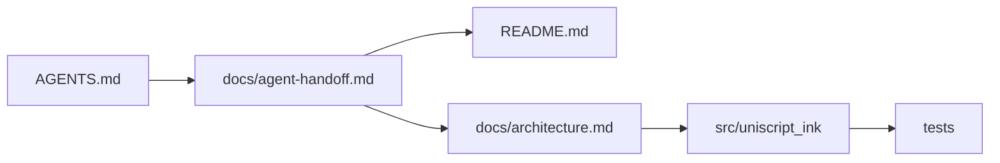
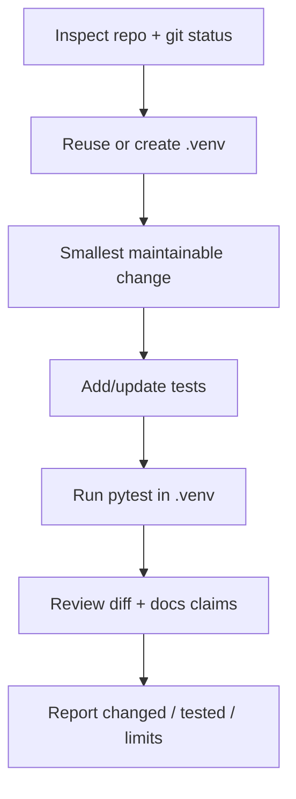

# AGENTS.md — UniScript Ink

Instructions for coding agents working in this repository. Follow these rules for every task.

## 0. Read first (agent connection)

Before writing code, read:

1. This file (`AGENTS.md`)
2. `README.md` — user workflow and current phase claims
3. `docs/agent-handoff.md` — phase ownership and IR contracts
4. `docs/architecture.md` — pipeline and module boundaries
5. `docs/script-coverage.md` and `docs/limitations.md` — honesty constraints



**Mission:** convert supported documents into coherent handwritten high-resolution pages with one consistent writer identity across languages and pages. Preserve content. No silent glyph loss. No artefact camouflage. Prefer CPU-only. Claim only what tests prove.

## 1. Mandatory Python virtual environment

**All project Python execution, dependency installation, scripts, tests, linters, and formatters must run inside the repository's `.venv`. Never install project packages into the system Python or a user-global Python environment.**

1. Start by checking the repository root, existing environment, project instructions, and Git status.
2. Reuse `.venv` if it exists. Otherwise create it from the available Python 3 interpreter:
   ```bash
   python3 -m venv .venv
   ```
   Creating the environment is the only permitted use of the system interpreter for project setup; do not use it to run project code or install project packages.
3. Use explicit environment paths so commands remain safe even when shell activation does not persist:
   ```bash
   ./.venv/bin/python --version
   ./.venv/bin/python -m pip install -r requirements.txt
   ./.venv/bin/python -m pytest
   ```
   Adapt dependency and test commands to the files actually present in the repository. On Windows, use `.venv\Scripts\python.exe`.
4. Use `./.venv/bin/python -m pip ...` for pip operations. Do not use bare `pip`, `sudo pip`, global package managers, or system-wide installation commands for project dependencies.
5. If `.venv` is broken, diagnose and repair it locally. Do not delete or recreate it without checking whether that would destroy useful local setup. Do not modify the user's global Python configuration.
6. Keep `.venv/` out of Git. Never commit the environment, caches, local secrets, tokens, private keys, or machine-specific configuration.
7. If a required package cannot be installed in `.venv`, explain the blocker and provide a safe local alternative; do not silently fall back to global installation.

## 2. Git-safe, push-ready workflow

The goal is to leave changes easy to review and push without surprising the user.

- Before editing, run `git status --short --branch` and inspect relevant files and repository instructions.
- Preserve pre-existing user changes. Do not reset, clean, stash, discard, or overwrite unrelated work.
- Work on the current branch unless the user directs otherwise. Do not rewrite Git history or use force-push.
- Keep changes focused, reasonably small, and reproducible. Avoid unrelated refactors and generated-file churn.
- Update the appropriate dependency manifest and setup documentation whenever dependencies or setup steps change. Do not commit a full environment freeze containing unrelated packages.
- Check `.gitignore` for `.venv/`, Python bytecode and test/linter caches, local `.env` files, temporary files, and large generated artifacts. Do not ignore source files or required fixtures. Do not add model weights or large rendered outputs by default; document how to obtain or regenerate them. Keep intentionally maintained examples and quality reports versioned when useful.
- Never put credentials, absolute machine-specific paths, private user documents, or machine-specific output into tracked files.
- Before finishing, run relevant checks in `.venv`, review `git diff --check`, `git diff`, and `git status --short`, and summarize tests and known limitations.
- **Do not commit or push unless the user explicitly requests it.** When the user allows timewise commits (as in this project), create focused commits and credit both the owner and the agent with `Co-authored-by` trailers. Do not change `git config`. Never force-push. Never print or expose credentials.
- Do not claim a feature or test passed unless it was actually implemented or run. If a check cannot run, say why.

Suggested trailer pair when committing:

```text
Co-authored-by: samirunuwanaka <samirunuwanaka@gmail.com>
Co-authored-by: Auto <auto@cursor.local>
```

## 3. Project goals and engineering constraints

UniScript Ink converts supported documents into coherent handwritten-style, high-resolution page images while preserving original content. Build working software, not just a mock-up or proposal.

- Preserve the user's original input files unchanged. Work on extracted or temporary copies where transformation is required.
- Keep the pipeline modular: input adapters; structured document representation; language/script detection and shaping; handwriting styles and synthesis; equations; figures/tables; page layout; rendering/scanning; quality checks; and export.
- Prefer structured parsers or compiler-based extraction to regular-expression-only parsing. Use independent, tested adapters for supported formats such as LaTeX, DOCX, PDF, plain text, and Markdown.
- Treat uploaded documents as untrusted input. Do not execute embedded shell commands. Keep LaTeX shell escape disabled by default, use timeouts and restricted compilation where available, and avoid unsafe temporary-file handling.
- Preserve Unicode and mixed-script text. Handle bidirectional text, shaping, combining marks, and missing glyphs explicitly. Never silently replace unsupported characters with blank boxes or claim full script support without tests.
- Keep mathematical structure and diagram meaning intact. Do not flatten equations into plain strings when that loses meaning, or distort graph data, circuit connections, flowchart relationships, or geometry.
- Keep handwriting style parameters reusable and consistent across pages and scripts. Clearly label glyph/font-based fallback rendering; do not present it as genuine stroke synthesis.
- Prefer a functional CPU-only path. Add heavyweight ML dependencies, download large models, or train models only when justified by the task and documented requirements.
- Preserve readability and page boundaries. Report uncertain OCR, missing glyphs, clipping, overlaps, unsupported features, and other content-integrity risks rather than hiding them with visual effects.
- Provide high-resolution JPG export and preserve optional PNG/PDF exports if implemented. Keep output settings and warnings reproducible and documented.
- Make claims only at the level supported by working code, tests, and evaluation. Distinguish implemented functionality from planned work and fallback behaviour.

## 4. Recommended development loop



1. Inspect the repository, `README`, dependency manifests, tests, and Git status.
2. Set up or reuse `.venv` and install only the dependencies needed for the task.
3. Make the smallest maintainable change that satisfies the task.
4. Add or update tests, especially for Unicode preservation, input parsing, layout/content integrity, and export behaviour where relevant.
5. Run targeted tests first, then broader checks when practical, using `.venv` explicitly.
6. Review diffs for accidental input changes, secrets, generated binaries, dependency noise, and unrelated edits.
7. Report what changed, exact checks run, any skipped checks, and remaining limitations. Leave the worktree ready for the user's requested Git workflow.

## 5. Repository conventions

Follow the repository's existing structure where possible. Evolve incrementally; do not create empty trees for unimplemented phases.

```
src/uniscript_ink/
  parsers/       # document input adapters
  languages/     # Unicode, script detection, shaping, bidi
  handwriting/   # style profiles, stroke synthesis, glyph fallbacks
  math/          # equation extraction and rendering (later)
  figures/       # figure classification and sketch conversion (later)
  layout/        # layout, tables, pagination
  rendering/     # vector/raster rendering
  scanning/      # optional scan simulation
  quality/       # verification and warnings
  export/        # JPG, PNG, PDF export
  ui/            # user interface (later)
configs/         # profiles and paper presets
tests/ examples/ docs/ results/ models/
```

## 6. Definition of done (per task)

- Code runs in `.venv`
- Relevant tests pass
- Docs/README claims still accurate
- Warnings surface for unsupported content
- One handwriting profile used for the whole document job
- No commit/push unless requested (or explicitly allowed for timewise commits)
