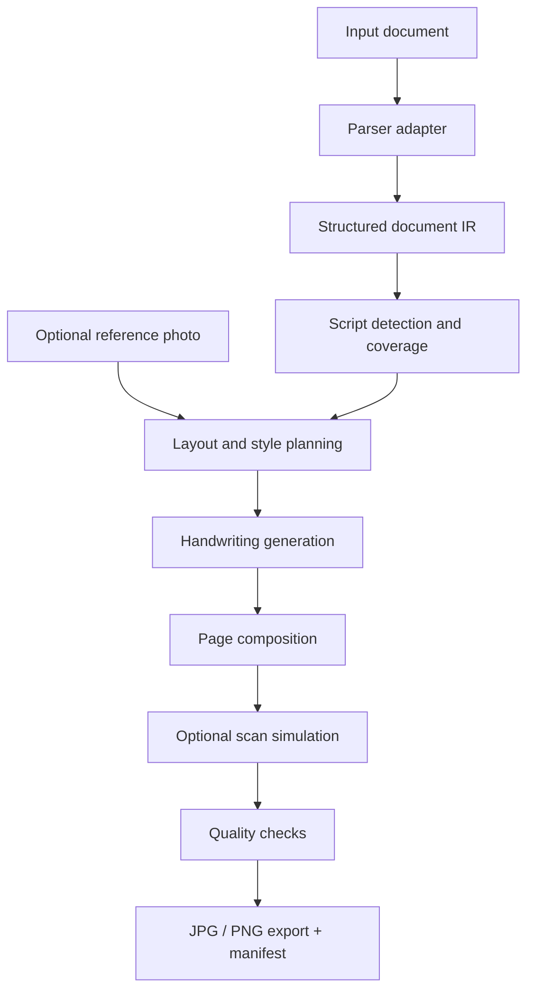
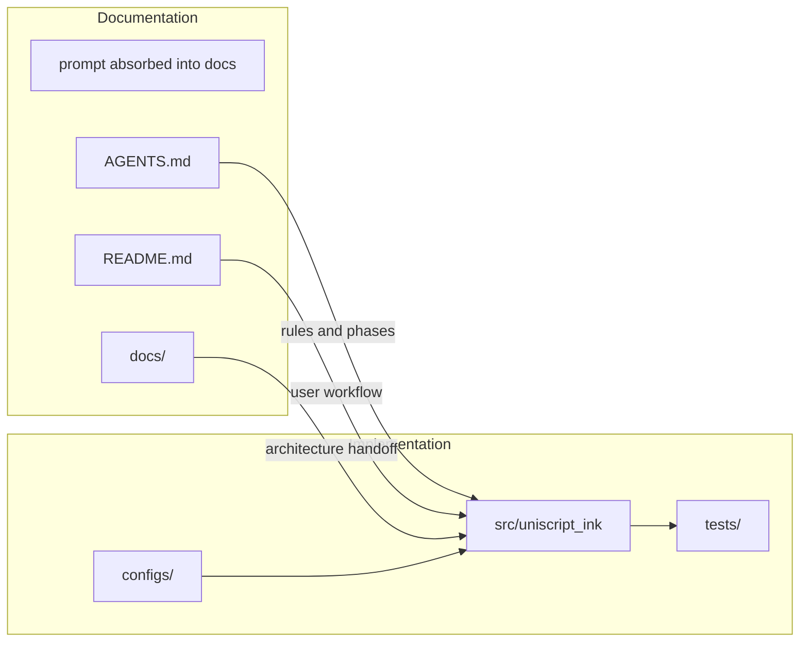
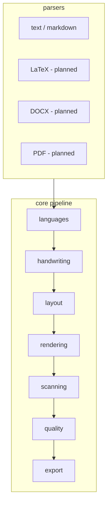
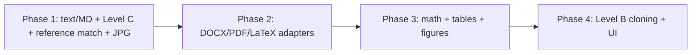

# UniScript Ink

**Multilingual handwriting and document rendering engine.**

UniScript Ink converts supported documents into coherent handwritten-style, high-resolution page images while preserving original content. One handwriting identity stays consistent across pages, scripts, equations, and eligible diagrams.

> Status: **Phase 1 working** — plain text / Markdown → consistent glyph-handwriting pages → JPG export. Additional parsers (LaTeX, DOCX, PDF), stroke synthesis, and UI land in later phases. Claims below match implemented code and tests.

## What it does

| Input (Phase 1) | Output |
|-----------------|--------|
| `.txt`, `.md` | High-resolution JPG pages |
| Unicode / mixed scripts | Script coverage report + warnings |
| Style profile presets | Same pen identity across the document |
| Optional handwriting photo (`--reference`) | Matched visual identity (ink, slant, weight, spacing) for the whole job |

Original source files are never modified. Processing uses temporary copies and structured intermediate data.

## Quick start

```powershell
# From the repository root (Windows)
python -m venv .venv
.\.venv\Scripts\python.exe -m pip install -r requirements.txt
.\.venv\Scripts\python.exe -m pip install -e .

# Render an example
.\.venv\Scripts\python.exe -m uniscript_ink render examples\sample_multilingual.md --out results\generated
```

```bash
# macOS / Linux
python3 -m venv .venv
./.venv/bin/python -m pip install -r requirements.txt
./.venv/bin/python -m pip install -e .
./.venv/bin/python -m uniscript_ink render examples/sample_multilingual.md --out results/generated
```

Run tests:

```powershell
.\.venv\Scripts\python.exe -m pytest -q
```

## How to use

1. **Choose input** — Phase 1: `.txt` or `.md`.
2. **Pick a handwriting profile** — e.g. `neat_student`, `everyday`, `ballpoint`, `pencil`.
3. **Optional: pass your handwriting photo** — `--reference` matches ink, slant, weight, and spacing for the whole document.
4. **Pick paper** — `blank`, `ruled`, `notebook`, `graph`.
5. **Render** — pages are composed, lightly scan-simulated (optional), and exported as JPG.
6. **Review warnings** — missing glyphs, unsupported scripts, and layout risks are reported, not hidden.

```powershell
.\.venv\Scripts\python.exe -m uniscript_ink render path\to\doc.md `
  --profile everyday `
  --paper ruled `
  --dpi 200 `
  --out results\generated
```

Match a personal handwriting sample (optional):

```powershell
.\.venv\Scripts\python.exe -m uniscript_ink analyze-reference path\to\my_handwriting.jpg
.\.venv\Scripts\python.exe -m uniscript_ink render path\to\doc.md `
  --reference path\to\my_handwriting.jpg `
  --out results\generated
```

List profiles and paper styles:

```powershell
.\.venv\Scripts\python.exe -m uniscript_ink profiles
.\.venv\Scripts\python.exe -m uniscript_ink papers
```

Details and honesty bounds: [docs/reference-handwriting.md](docs/reference-handwriting.md).

## End-to-end workflow



## Agent collaboration map

Coding agents share one source of truth so handoffs stay consistent:



See [docs/agent-handoff.md](docs/agent-handoff.md) for phase ownership, IR contracts, and “do not claim until tested” rules.

## Architecture (modules)



## Handwriting identity

Every page in one job uses the same **style profile** (stroke width, ink colour, slant, spacing, drift, variation). Script-specific shaping is allowed; unrelated “font mashups” are not.

| Level | Meaning | Phase 1 |
|-------|---------|---------|
| A | Genuine stroke trajectories | Planned |
| B | Learned stroke / few-shot cloning from a reference | Planned |
| C | Script-aware glyph fallback with controlled variation | **Implemented** |
| C-reference | Optional photo → matched ink/slant/weight/spacing for the job | **Implemented** |

Level C / C-reference are labelled as glyph-based fallback — not claimed as genuine pen kinematics or pixel-perfect letter cloning.

## Repository layout

```
src/uniscript_ink/   # application package
configs/             # handwriting profiles, paper, render defaults
docs/                # architecture, agent handoff, script coverage
examples/            # sample multilingual documents
tests/               # automated tests
results/             # generated outputs (local; not committed by default)
models/              # model metadata (weights stay untracked)
```

## Documentation index

| Doc | Purpose |
|-----|---------|
| [AGENTS.md](AGENTS.md) | Rules for coding agents (venv, git, quality bar) |
| [docs/architecture.md](docs/architecture.md) | Pipeline, modules, data contracts |
| [docs/agent-handoff.md](docs/agent-handoff.md) | How agents continue each other’s work |
| [docs/script-coverage.md](docs/script-coverage.md) | Script support matrix and honesty rules |
| [docs/limitations.md](docs/limitations.md) | Known limits and fallbacks |
| [docs/reference-handwriting.md](docs/reference-handwriting.md) | Optional handwriting photo matching |

## Development phases



## License and attribution

Project: **UniScript Ink**. Development commits may credit both the repository owner and collaborating agents via `Co-authored-by` trailers.
