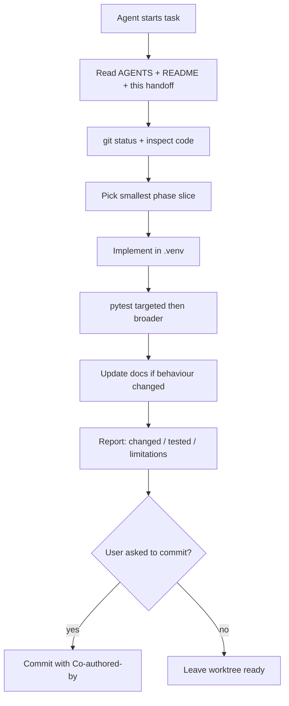
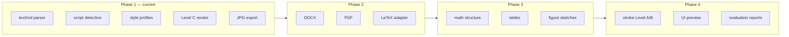

# Agent handoff guide

This document connects coding agents that implement UniScript Ink so each session continues from the same contracts, phases, and honesty rules.

## Shared sources of truth

| Artifact | Agents must read | Purpose |
|----------|------------------|---------|
| `AGENTS.md` | Always | Venv, git safety, quality bar |
| `README.md` | Before user-facing changes | Workflow and claims |
| `docs/architecture.md` | Before pipeline edits | IR and module boundaries |
| `docs/script-coverage.md` | Before language claims | What is tested vs planned |
| `docs/limitations.md` | Before closing a task | Known gaps |
| `configs/` | Before style/render changes | Profiles and paper presets |
| `tests/` | Before claiming done | Evidence |



## Phase ownership

Agents should extend the current phase instead of rewriting the stack.



| Phase | Done when | Next agent should |
|-------|-----------|-------------------|
| 1 | `render` CLI works for `.txt`/`.md`, optional `--reference` style match, tests pass, Level C labelled | Add DOCX/PDF/LaTeX adapters without changing IR consumers; Level B glyph cloning later |
| 2 | Independent tested adapters | Keep maths as structured blocks |
| 3 | Equations/tables/figures preserve meaning | Add stroke models behind the same profile API |
| 4 | Preview UI + evaluation | Do not claim human-indistinguishable handwriting |

## Handoff checklist (copy into agent reports)

```text
[ ] Original inputs untouched
[ ] Changes scoped to one phase slice
[ ] IR contract unchanged or docs+tests updated together
[ ] Style profile reused for whole document
[ ] Unsupported scripts/glyphs reported, not blanked
[ ] Tests run in .venv and listed
[ ] README/docs claims match code
[ ] No secrets, .venv, or large binaries staged
```

## Commit convention (when user asks)

Use clear messages. Credit both the repository owner and the collaborating agent:

```text
Short why-focused subject.

Co-authored-by: samirunuwanaka <samirunuwanaka@gmail.com>
Co-authored-by: Auto <auto@cursor.local>
```

Do not change `git config`. Do not push unless asked.

## Anti-drift rules

1. **No fake completeness** — if only Level C exists, say so.
2. **No silent glyph loss** — missing coverage → warning in report/manifest.
3. **No regex-only LaTeX** — prefer structured/compiler extraction when added.
4. **No artefact camouflage** — scanning must not hide layout or glyph errors.
5. **Minimum tokens, maximum signal** — small diffs, targeted tests, no unrelated refactors.
