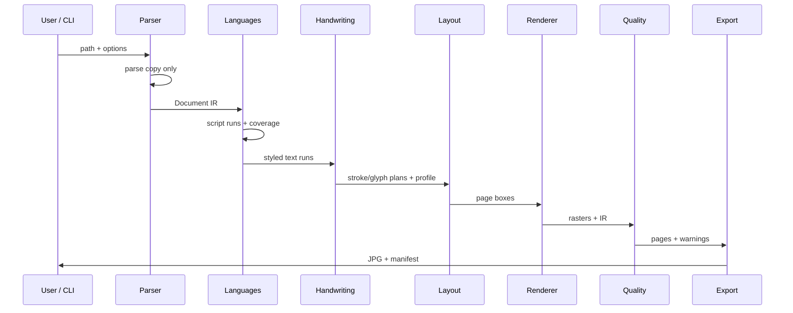
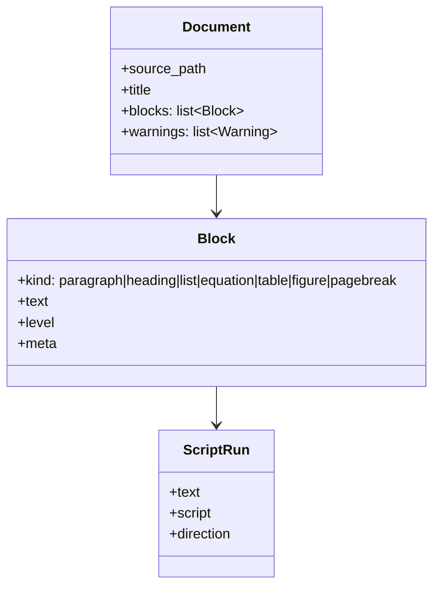
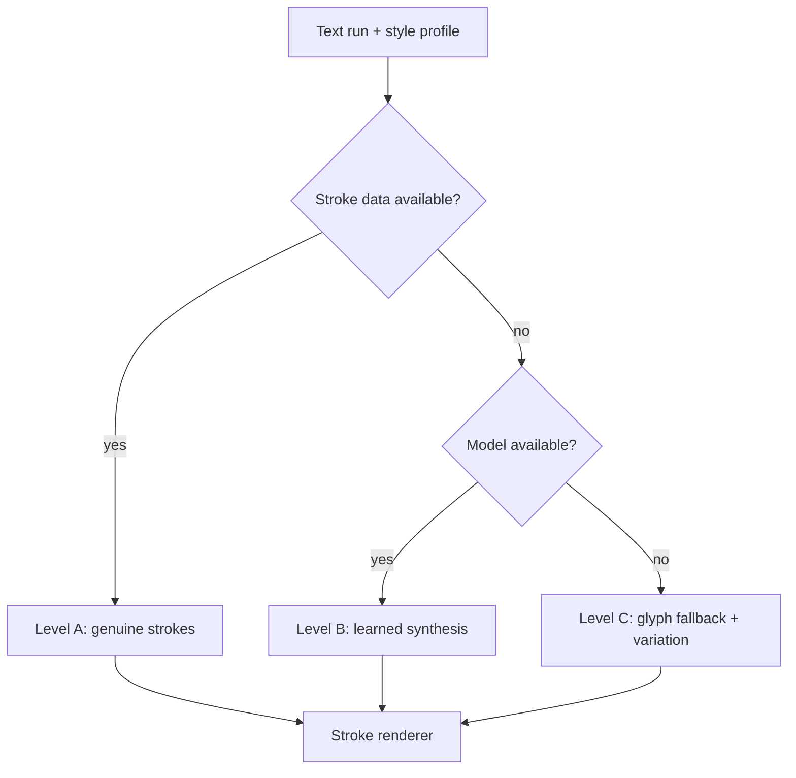

# Architecture — UniScript Ink

## Goal

Turn supported documents into readable handwritten page images without changing the source file, without inventing content, and without using scan artefacts to hide errors.

## Pipeline

## Intermediate representation (IR)

All adapters emit the same IR so later stages stay format-agnostic.

**Contract for agents:** do not invent new IR fields without updating `docs/agent-handoff.md`, parsers, and tests together.

## Module responsibilities

| Package | Responsibility | Must not |
|---------|----------------|----------|
| `parsers` | Extract structure from input copies | Mutate originals; shell-escape LaTeX |
| `languages` | Detect scripts, normalize Unicode, shape/bidi | Silently drop unsupported glyphs |
| `handwriting` | Apply one style profile; Level A/B/C synthesis | Mix unrelated styles in one job |
| `math` | Keep equation structure | Flatten maths into lossy plain strings |
| `figures` | Classify and sketch safely | Break connections / invent data |
| `layout` | Paginate without clipping | Shrink fonts arbitrarily to “fit” |
| `rendering` | Vector → raster | Hide missing glyphs |
| `scanning` | Subtle clean-scan look | Fake damage by default |
| `quality` | Verify and warn | Auto-correct meaning |
| `export` | JPG/PNG/PDF + manifest | Absolute machine paths in tracked files |

## Handwriting levels

Phase 1 ships **Level C only**, labelled in manifests and quality reports.

## Security defaults

- Treat uploads as untrusted.
- No execution of embedded shell commands.
- LaTeX shell escape disabled when LaTeX support lands.
- Timeouts and restricted temp directories for compilation-based extraction.

## Performance principles

- Prefer CPU-only path.
- Avoid heavy ML deps until a phase requires them.
- Process small fixtures in tests; do not regenerate large artefacts in CI by default.
- Keep style profile application O(pages × runs) with shared font/profile caches.
