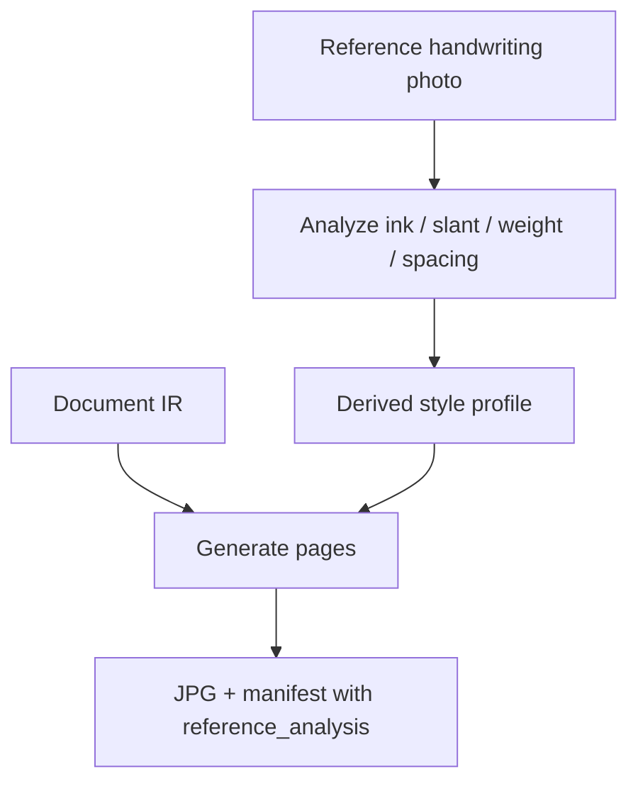
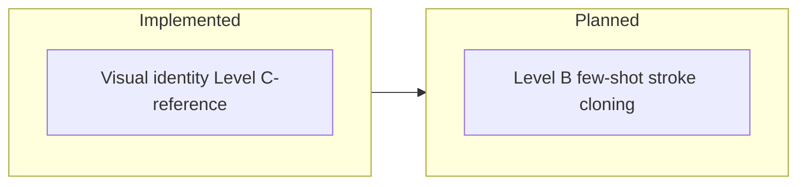

# Optional reference handwriting matching

Users may supply a photo of their own handwriting. UniScript Ink analyzes it once and applies a **single matched style identity** to every page and script in that job.

## How to use

```powershell
# Preview what will be extracted
.\.venv\Scripts\python.exe -m uniscript_ink analyze-reference path\to\my_handwriting.jpg

# Render a document using that identity
.\.venv\Scripts\python.exe -m uniscript_ink render examples\hello.txt `
  --reference path\to\my_handwriting.jpg `
  --profile everyday `
  --out results\generated
```

`--profile` remains the **base preset** used when reference confidence is low (safe blend).

## Workflow



## What is matched today (Phase 1)

| Trait | Matched |
|-------|---------|
| Ink colour | Yes |
| Ink opacity / contrast | Yes |
| Stroke weight | Yes (approximate) |
| Slant | Yes (approximate) |
| Character / word spacing | Yes (density heuristic) |
| Baseline / line drift | Yes |
| Same identity across all pages/scripts | Yes |
| Exact personal letter shapes / stroke order | **Not yet** (Level B) |



## Tips for best results

- Use a clear photo: dark ink on light paper, good lighting, little shadow.
- Prefer a few lines of normal writing, not a single oversized letter.
- Avoid heavy ruled lines dominating the frame when possible.
- Keep the original reference file; the pipeline only reads it.

## Honesty rule for agents

Do not claim “pixel-perfect replica of every letter” until Level B cloning is implemented and tested. Do claim: optional reference photo → matched visual handwriting identity for the whole document.
