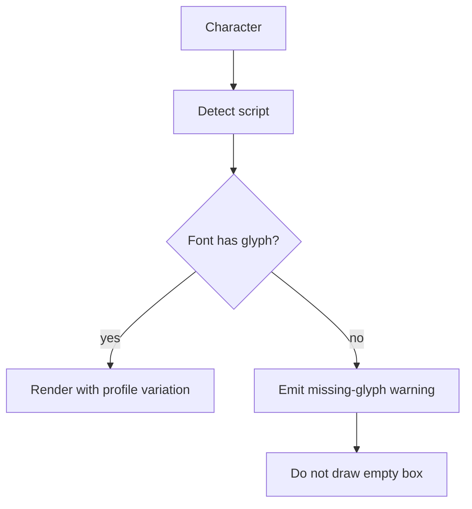

# Script coverage

Honest matrix. A script is **supported** only when detection, shaping/layout assumptions, glyph coverage, and tests pass.

| Script | Detection | Glyph render (Level C) | Tests | Status |
|--------|-----------|------------------------|-------|--------|
| Latin | Yes | Yes (system / bundled handwriting fonts) | Yes | Phase 1 |
| Greek | Yes | Best-effort if font covers | Partial | Experimental |
| Cyrillic | Yes | Best-effort if font covers | Partial | Experimental |
| Sinhala | Yes | Best-effort if font covers | Partial | Experimental |
| Tamil | Yes | Best-effort if font covers | Partial | Experimental |
| Arabic | Detected | Needs shaping/bidi | Planned | Detect only |
| Hebrew | Detected | Needs shaping/bidi | Planned | Detect only |
| Devanagari | Detected | Best-effort if font covers | Partial | Experimental |
| Bengali | Detected | Best-effort if font covers | Partial | Experimental |
| Thai | Detected | Best-effort if font covers | Partial | Experimental |
| Chinese / Japanese / Korean | Detected | Best-effort if font covers | Partial | Experimental |

## Rules

- Mixed-script paragraphs are split into script runs.
- RTL scripts are detected and flagged until HarfBuzz/FriBidi integration lands.
- Never claim full support without tests in `tests/`.
