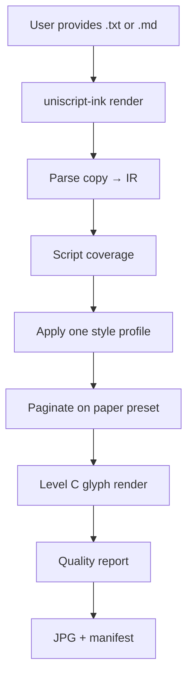
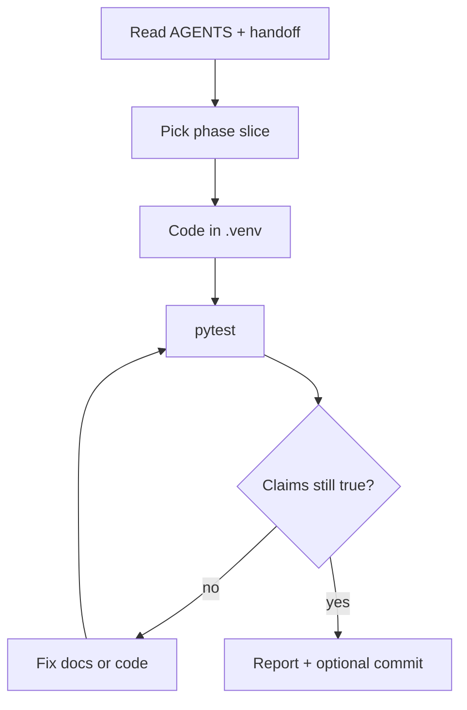

# User and agent workflow

## User render path

## Agent implementation path

## Keeping handwriting identity stable

1. Load one profile per job (`--profile`).
2. Seed variation from `source_path + profile + title` so reruns are reproducible.
3. Do not swap fonts/profiles mid-document.
4. Language change only adapts shaping needs; ink, slant, spacing stay from the profile.
